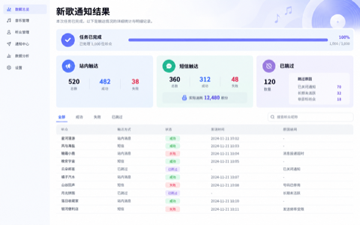

# Golden Example：复杂需求——新歌通知

> 通用虚构音乐产品案例，不包含任何真实公司、业务或内部规则。

## 示例定位

- 难度：复杂
- 需求类型：多渠道通知、积分计费、异步结果与权限控制
- 教学目标：在一个闭环中写清判断维度、渠道关系、计费口径、状态和异常

## 一、输入材料摘要

音乐运营人员发布新歌后，需要向订阅听众发送通知。现有站内通知无法覆盖未安装应用但留有手机号的听众，也缺少统一的发送进度、失败原因和消费记录。

本期支持站内消息和短信两种渠道，短信使用团队积分；发送后统一展示结果和明细。

## 二、最终 PRD 示例

### 一、变更记录

| 修改时间 | 修改内容 | 修改人 |
|-|-|-|
| 2026.10.15 | 新建文档 | 产品经理 |

### 二、需求背景

当前新歌通知仅支持站内消息，未安装应用但留有手机号的听众无法收到通知。发送完成后也缺少统一的进度、失败原因和费用记录。

本期增加短信通知，并按照听众实际可用的联系方式决定触达渠道；短信成功发送后扣除团队积分。发送过程和结果在同一页面承接。

### 三、产品需求

#### 1. 整体流程

`选择歌曲与听众 → 确认通知渠道和范围 → 校验积分 → 提交发送 → 查看进度与结果`

#### 2. 产品方案

| 模块 | 图 | 产品逻辑描述 |
|-|-|-|
| 触达能力 |  | **1. 判断维度**：分别判断站内与短信能力，两种能力可以同时成立。
**2. 不可触达**：两个渠道均不可用时不进入发送队列，并记录原因。 |
| 通知渠道 | 同上 | **1. 站内消息**：默认开启。
**2. 短信**：默认关闭；开启后选择“仅补充站内不可触达听众”或“全部可短信触达听众”。
**3. 渠道关系**：选择全部时，同一听众可以同时收到两种通知。 |
| 积分计费 | 同上 | **1. 预计消耗**：预计短信条数 × 当前单价。
**2. 实际消耗**：成功短信条数 × 当前单价；失败和已跳过不扣积分。
**3. 积分不足**：不得提交；充值成功只更新余额，不自动发送。 |
| 确认发送 | 同上 | **1. 提交**：再次校验触达能力、渠道、短信范围和积分。
**2. 队列**：两种渠道分别进入对应队列；无渠道发送的听众记为已跳过。
**3. 防重复**：重复点击不得重复创建任务或扣费。 |
| 发送结果 |  | **1. 进度**：处理中展示“已处理 X / Y”。
**2. 汇总**：展示站内、短信和已跳过；短信同时展示实际积分。
**3. 顶部状态**：至少一条成功为“发送已完成”；全部发送任务失败为“发送失败”；已跳过不参与判断。 |
| 结果明细 | 同上 | **1. 筛选**：全部、成功、失败、已跳过。
**2. 字段**：听众、触达方式、状态、发送时间、原因。
**3. 维度**：多渠道按渠道展示；已跳过按听众展示。 |
| 权限 | — | 分为查看发送记录、使用短信和积分充值。无短信权限时仅可使用站内消息；无充值权限时可以使用现有积分；无记录权限时不展示历史入口。 |

> 图片均为虚构音乐产品界面。示例数字只用于说明结构，不形成固定计费规则。

#### 3. 验收要点

1. 两种渠道能力独立判断，并能按短信范围正确生成任务。
2. 预计积分、实际积分和失败不扣费口径一致。
3. 积分不足时不能提交，充值成功后不会自动发送。
4. 重复点击不会重复创建批次或重复扣费。
5. 汇总卡片、顶部状态和明细记录使用一致的统计维度。
6. 权限不足时入口和可操作范围符合规则。

## 三、完整度检查

| 检查维度 | 结果 | 说明 |
|-|-|-|
| 需求目标 | 通过 | 解决触达覆盖、结果追踪和费用记录问题。 |
| 功能流程 | 通过 | 覆盖配置、校验、发送、进度和结果。 |
| 业务规则 | 通过 | 明确能力、渠道、范围、计费和统计规则。 |
| 状态流转 | 通过 | 覆盖处理中、完成、失败和已跳过。 |
| 数据处理 | 通过 | 明确批次、渠道任务和积分记录。 |
| 权限控制 | 通过 | 覆盖记录、短信和充值权限。 |
| 异常边界 | 通过 | 覆盖积分不足、发送失败和重复提交。 |
| 现有能力复用 | 通过 | 复用站内通知、短信、积分和权限能力。 |
| 逻辑一致性 | 通过 | 汇总、状态、明细和扣费维度一致。 |
| 可验收性 | 通过 | 核心规则均能转化为测试条件。 |

## 四、Skill 应学习的写法

1. 所有 PRD 必须包含“一、变更记录”和“二、需求背景”。
2. 复杂需求先给整体流程，再在三列表格中拆分模块规则。
3. 同时写清判断对象、统计维度、触发条件、结果和异常。
4. 预计值与实际值必须分别定义，失败和跳过是否计费要明确。
5. 汇总状态与明细数据必须使用一致口径。
6. 示例只学习写法，不学习虚构数字或音乐业务设定。

## 五、公开使用检查

- 案例与图片均为虚构音乐产品内容。
- 不含真实项目、公司、行业、品类、平台、人员或内部数据。
- 不含内部链接、文档 ID、附件 token 或评论。
