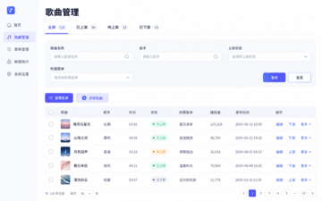
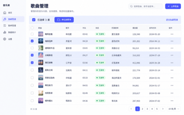

# Golden Example：中等需求——歌曲管理列表改版

> 通用虚构音乐产品案例，不包含任何真实项目、公司、行业、品类或内部业务信息。

## 示例定位

- 难度：中等
- 需求类型：存量列表的信息架构与管理效率优化
- 教学目标：写清状态、筛选、列表、行内操作、批量操作和分页之间的联动

## 一、输入材料摘要

现有歌曲管理页采用卡片列表，状态、筛选和管理操作分散，单屏信息量有限。随着筛选条件增加，页面难以继续扩展，也不利于连续对比和批量整理歌曲。

本期保留已有歌曲上传、上下架和权限逻辑，只调整页面层级、列表形式、筛选方式及轻量批量管理能力。

## 二、最终 PRD 示例

### 一、变更记录

| 修改时间 | 修改内容 | 修改人 |
|-|-|-|
| 2026.10.15 | 新建文档 | 产品经理 |

### 二、需求背景

当前歌曲管理页采用卡片布局，状态入口、筛选条件与管理操作缺少清晰分层，用户难以快速定位、比较和整理多首歌曲。

本期将页面调整为“状态层 → 页面级操作 → 筛选层 → 列表层”，并将卡片改为表格，提高信息密度和后续扩展能力。已有上传、上下架、权限和状态流转逻辑继续复用。

### 三、产品需求

#### 1. 产品方案

| 模块 | 图 | 产品逻辑描述 |
|-|-|-|
| 状态与筛选 |  | **1. 状态切换**：展示各状态及数量；切换后刷新列表并返回第 1 页，状态与已生效筛选条件取交集。
**2. 筛选查询**：歌曲名称、歌手、上架状态和所属歌单之间取 AND 交集；点击查询后统一生效。
**3. 数量更新**：查询生效后同步刷新各状态数量。 |
| 列表与跳转 | 同上 | **1. 列表展示**：每首歌曲占一行，展示歌曲、歌手、时长、状态、所属歌单、播放量、发布时间和操作。
**2. 详情跳转**：Checkbox、歌单控件和行内操作不触发详情。
**3. 播放量**：无数据时展示“0”。 |
| 单条操作 | 同上 | **1. 所属歌单**：保存成功后只更新当前行。
**2. 状态操作**：按当前状态展示上架、下架或重新上架。
**3. 复用范围**：确认弹窗、权限和状态流转沿用现有逻辑。 |
| 批量管理 |  | **1. 进入批量状态**：仅点击 Checkbox 才选中歌曲；选中后显示批量操作栏。
**2. 操作范围**：只支持移动到歌单。
**3. 选中状态**：退出或切页后清空选择；查询、重置、状态切换和排序后返回第 1 页。 |

> 图片均为虚构音乐产品界面。布局、颜色和示例数据只用于辅助理解，最终以产品逻辑描述为准。

#### 2. 验收要点

1. 状态与已生效筛选条件取交集，查询前后的状态数量变化符合规则。
2. 查询、重置、状态切换和排序后返回第 1 页。
3. 行内交互不会误触发歌曲详情。
4. 无播放数据时展示“0”。
5. 批量状态只提供移动到歌单，退出或切页后清空选择。

## 三、完整度检查

| 检查维度 | 结果 | 说明 |
|-|-|-|
| 需求目标 | 通过 | 明确提高歌曲浏览、定位、比较和整理效率。 |
| 功能流程 | 通过 | 覆盖状态、筛选、查看、单条管理和批量管理。 |
| 业务规则 | 通过 | 明确条件关系、生效时机和分页规则。 |
| 状态流转 | 通过 | 上下架操作复用已有逻辑。 |
| 数据处理 | 通过 | 明确数量和选中状态的更新时机。 |
| 权限控制 | 通过 | 权限沿用现有逻辑，不新增规则。 |
| 异常边界 | 通过 | 覆盖无播放数据与交互区域误触边界。 |
| 现有能力复用 | 通过 | 明确复用确认弹窗、权限和状态流转。 |
| 逻辑一致性 | 通过 | 状态、筛选、分页和选择状态联动一致。 |
| 可验收性 | 通过 | 主要交互均有明确输入、触发和结果。 |

## 四、Skill 应学习的写法

1. 所有 PRD 必须包含“一、变更记录”和“二、需求背景”，不因需求简单而省略。
2. 产品方案固定使用“模块｜图｜产品逻辑描述”三列表格。
3. 涉及筛选时，写清条件关系、生效时机以及对数量和分页的影响。
4. 涉及行点击时，区分详情热区与独立交互控件。
5. 批量操作写清进入条件、允许操作、退出方式和状态清理。
6. 已有成熟能力明确写“复用”，避免扩大本期范围。
7. 公开示例不得出现真实项目、公司、行业、品类或内部业务映射。

## 五、公开使用检查

- 案例和图片均为虚构音乐产品内容。
- 不含真实项目、公司、行业、品类、平台、人员或内部数据。
- 不含内部链接、文档 ID、附件 token 或评论。
