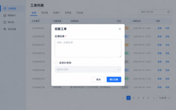
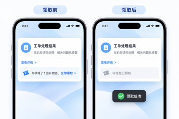

# Golden Example：简单需求——工单处理结果通知

> 通用虚构案例。仅用于展示 PRD 写作方法，不包含任何真实产品、公司或业务信息。

## 示例定位

- 难度：简单
- 需求类型：存量通知能力修复与小范围增强
- 教学目标：让 AI 在简单需求中保持简洁，同时写清条件、状态和防重复规则

## 一、输入材料摘要

### 用户反馈

客服关闭工单后，用户会收到处理结果通知。目前所有通知正文都会显示“查看详情”入口；当工单关联的内容已被删除时，用户点击入口只能进入空页面。

客服还希望在处理特殊工单时，可以选择向用户发放一张补偿券。用户收到通知后，应能直接领取，并看到领取结果。

### 已知范围

- 调整管理端的工单回复表单。
- 调整用户端的处理结果通知。
- 复用现有通知和优惠券能力。
- 不改造工单流程，不新增通知分类。

## 二、最终 PRD 示例

### 一、变更记录

| 修改时间 | 修改内容 | 修改人 |
|-|-|-|
| 2026.10.15 | 新建文档 | 产品经理 |

### 二、需求背景

客服关闭工单后，系统会向用户发送处理结果通知。当前通知固定展示“查看详情”入口；当关联内容已被删除时，用户点击后会进入空页面。

本期根据关联内容是否有效决定是否展示跳转入口，并支持客服在回复工单时选择发放补偿券。用户可在通知页直接领取补偿券。

### 三、产品需求

#### 1. 产品方案

| 模块 | 图 | 产品逻辑描述 |
|-|-|-|
| 管理端回复工单 |  | **1. 处理结果**：处理结果必填。
**2. 发放补偿券**：选填，默认不勾选；勾选后必须选择一张当前可用的补偿券。
**3. 提交回复**：提交成功后关闭工单，并向提交人发送处理结果通知。 |
| 用户端处理结果通知 |  | **1. 处理结果**：展示 `你的反馈已处理：{处理结果}`。
**2. 详情入口**：关联内容有效时可以进入详情；内容已删除时展示“相关内容已失效”，不可点击。
**3. 补偿券展示**：未发放时不展示；发放时展示领取入口。 |
| 补偿券领取 | 同上 | **1. 领取操作**：在当前通知页领取。
**2. 领取成功**：Toast 提示“领取成功”，文案更新为“补偿券已领取”。
**3. 防重复领取**：领取成功后不可重复领取。 |
| 通知展示规则 | — | 普通通知文字仅展示；仅在存在有效目标页面时展示可点击入口。 |

> 图片均为虚构界面，只用于辅助理解产品逻辑。图片中的布局、颜色和示例数据不构成必须实现的需求，最终以“产品逻辑描述”为准。

#### 2. 验收要点

1. 关联内容有效时，通知入口可以进入正确详情页。
2. 关联内容失效时，通知不提供跳转能力。
3. 未选择补偿券时，用户端不展示领取区域。
4. 选择补偿券时，用户可以在通知页领取。
5. 领取成功后展示成功状态，再次点击不能重复领取。

## 三、完整度检查

| 检查维度 | 结果 | 说明 |
|-|-|-|
| 需求目标 | 通过 | 明确解决无有效目标页面仍可点击的问题。 |
| 功能流程 | 通过 | 覆盖客服回复、系统发通知、用户查看与领取。 |
| 业务规则 | 通过 | 明确必填、选填和条件展示规则。 |
| 状态流转 | 通过 | 覆盖补偿券未领取、领取成功和不可重复领取。 |
| 数据处理 | 通过 | 明确领取成功后更新领取状态。 |
| 权限控制 | 不适用 | 本需求不新增角色或权限规则。 |
| 异常边界 | 基本通过 | 覆盖目标内容失效和重复领取；不虚构网络异常规则。 |
| 现有能力复用 | 通过 | 复用现有通知和优惠券能力。 |
| 逻辑一致性 | 通过 | 所有入口均以目标页面是否有效为判断依据。 |
| 可验收性 | 通过 | 每个条件都有明确的展示或操作结果。 |

## 四、Skill 应学习的写法

1. 无论需求复杂度如何，最终 PRD 都必须包含“一、变更记录”和“二、需求背景”。
2. 简单需求直接说明现状问题和本期变化，不增加独立的“需求分析”章节。
3. 产品方案使用“模块｜图｜产品逻辑描述”三列表格，让界面与规则逐行对应。
4. 产品逻辑按编号拆分，在对应模块内写清条件、动作和结果。
5. 对条件分支同时写清“满足时”和“不满足时”的产品表现。
6. 有状态变化时，明确触发动作、成功反馈、结果状态和防重复规则。
7. 原始信息没有覆盖的内容保持待确认，不把建议自动写成正式需求。

## 五、Skill 不应学习的内容

1. 不把示例中的工单、补偿券设定当作固定 PRD 模板。
2. 不要求所有简单需求都具备多端、多角色或权益领取逻辑。
3. 不为了显得完整而自行补充过期、撤回、重试等未经确认的规则。
4. 不从截图或示例数据中推导新的产品要求。

## 六、公开使用检查

- 案例为虚构通用场景，不含真实产品或公司名称。
- 不含内部链接、文档 ID、真实截图、附件、评论和人员信息。
- 不含从真实材料中直接复制的专有术语、价格、权限或统计规则。
- 公开发布前仍需检查仓库中是否混入原始材料或历史版本。
